# Arquitectura del VPS y de las plataformas — grafo de procesos

> **Para quién es esto:** un colaborador promedio (marketing, ventas, soporte o un dev nuevo) que necesita entender *qué hay*, *dónde vive* y *cómo fluye* la información entre las plataformas de Diego Díaz / Díaz Lara.
> **Cómo leerlo:** empieza por el nivel 0 (el servidor), baja al nivel 1 (dominios y plataformas) y después entra al detalle de cada plataforma y sus procesos. Los diagramas son Mermaid: GitHub y la app de Copilot los renderizan solos.
> **Fuente:** inventario real del VPS (nginx, pm2, cron, MySQL) y lectura del código de los repos `DD_Frontend`, `DD_Backend`, `diazlara-backend`, `DiazLaraweb`, `Consultoria`, `Consultoria_backend` y `ranking-asesores`. Fecha: 2026‑11‑24. El servidor de Minecraft queda fuera de alcance por petición expresa.

---

## Índice

0. [Nivel 0 — El VPS](#nivel-0--el-vps)
1. [Nivel 1 — Dominios, hosting y plataformas](#nivel-1--dominios-hosting-y-plataformas)
2. [Plataforma A — Diego Díaz (diegodiaz.mx)](#plataforma-a--diego-díaz-diegodiazmx)
   - A1 Mapa del sitio · A2 Captación de leads · A3 HubSpot · A4 Email marketing (Mailchimp + SMTP) · A5 Pagos Stripe · A6 Eventos, boletos y check‑in · A7 Academia · A8 Cuentas · A9 Blog · A10 WhatsApp · A11 Reportes a Google Sheets · A12 Workers automáticos · A13 Panel admin
3. [Plataforma B — Díaz Lara Consultores (diazlara.mx)](#plataforma-b--díaz-lara-consultores-diazlaramx)
4. [Plataforma C — Consultoría interna (fiscalista-mx.com)](#plataforma-c--consultoría-interna-fiscalista-mxcom)
5. [Plataforma D — Ranking de asesores (ranking.diazlara.mx)](#plataforma-d--ranking-de-asesores-rankingdiazlaramx)
6. [Cómo se conectan las plataformas entre sí](#cómo-se-conectan-las-plataformas-entre-sí)
7. [Servicios externos (tabla rápida)](#servicios-externos-tabla-rápida)
8. [Operación: despliegues, tareas programadas y respaldos](#operación-despliegues-tareas-programadas-y-respaldos)
9. [Riesgos y pendientes detectados](#riesgos-y-pendientes-detectados)

---

## Nivel 0 — El VPS

**Servidor:** `82.25.95.236` · Ubuntu 25.04 · 4 vCPU · 15 GB RAM · 193 GB disco (19 % usado).
**Qué hace:** recibe todo el tráfico HTTPS en **nginx**, lo reparte a 4 procesos Node administrados por **PM2**, guarda datos en **MySQL** local y corre tareas programadas con **cron**. Los certificados SSL los renueva **Certbot**; **fail2ban** y **Monarx** protegen el acceso.

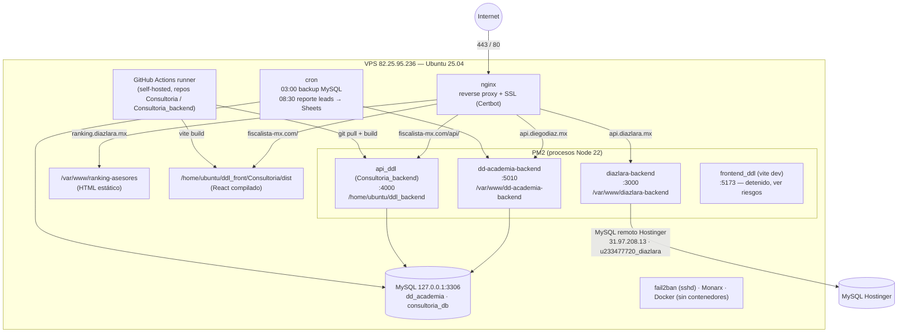

**Resumen por puerto**

| Puerto | Proceso PM2 | Repo | Dominio público |
|---|---|---|---|
| 5010 | `dd-academia-backend` | `JoseVargasCubillas/DD_Backend` | `api.diegodiaz.mx` (`api.consultoresddl.com.mx` deshabilitado, ver riesgos) |
| 3000 | `diazlara-backend` | `JoseVargasCubillas/diazlara-backend` | `api.diazlara.mx` |
| 4000 | `api_ddl` | `JoseVargasCubillas/Consultoria_backend` | `fiscalista-mx.com/api/` |
| 5173 | `frontend_ddl` (`npm run dev`, **detenido**) | `JoseVargasCubillas/Consultoria` | — (nginx sirve el `dist/` estático, no este puerto) |
| 80/443 estático | nginx | `ranking-asesores` | `ranking.diazlara.mx` |

---

## Nivel 1 — Dominios, hosting y plataformas

No todo vive en el VPS: los **frontends de Diego Díaz y Díaz Lara están en Hostinger** (hosting web con auto‑deploy desde GitHub); el VPS aloja sus APIs. `fiscalista-mx.com` pasa por **Cloudflare** antes de llegar al VPS.

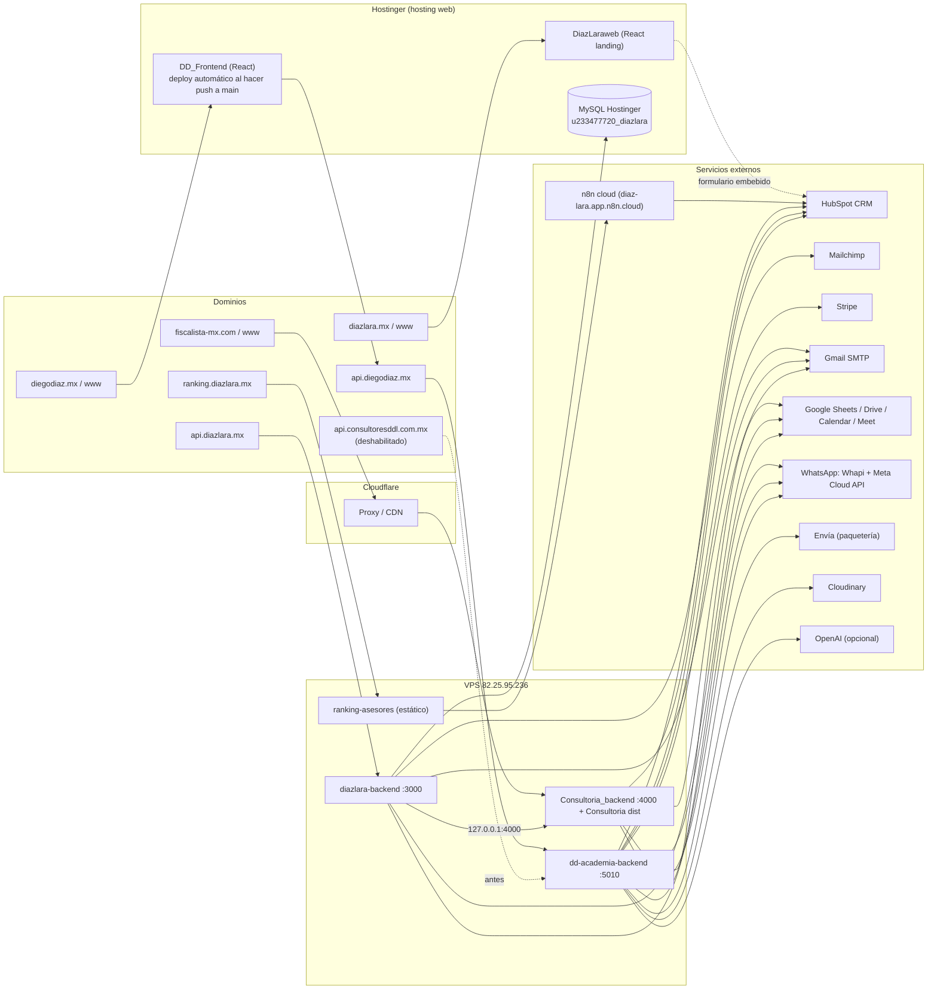

**Las cuatro plataformas**

| Letra | Plataforma | Para qué sirve | Frontend | Backend | Base de datos |
|---|---|---|---|---|---|
| **A** | **Diego Díaz** | Marca personal: eventos, Academia (cursos), libros, blog, captación de leads, marketing | `diegodiaz.mx` (Hostinger) | `api.diegodiaz.mx` (VPS :5010) | `dd_academia` (VPS) |
| **B** | **Díaz Lara Consultores** | Landing del despacho + API para agendar sesiones estratégicas con consultores | `diazlara.mx` (Hostinger) | `api.diazlara.mx` (VPS :3000) | `u233477720_diazlara` (Hostinger) |
| **C** | **Consultoría interna** | Sistema operativo del despacho: clientes, pipeline HubSpot, tareas, documentos, sesiones, portal de cliente, podio | `fiscalista-mx.com` (Cloudflare → VPS) | `fiscalista-mx.com/api` (VPS :4000) | `consultoria_db` (VPS) |
| **D** | **Ranking de asesores** | Pantalla/tablero en vivo con ranking de ventas desde HubSpot | `ranking.diazlara.mx` (VPS estático) | n8n cloud (webhooks) | — |

---

## Plataforma A — Diego Díaz (diegodiaz.mx)

**Stack:** React 18 + Vite + TypeScript (Tailwind, React Router, TanStack Query, Zustand) en el frontend; Node + Express + TypeScript en el backend; MySQL con tablas `id + data(JSON)`.
**Deploy:** frontend → push a `main` en `DD_Frontend` y Hostinger compila y publica (~3‑4 min). Backend → push a `main` en `DD_Backend` y después `git pull && npm install && npm run build && pm2 restart dd-academia-backend` en el VPS.

### A1 · Mapa del sitio público

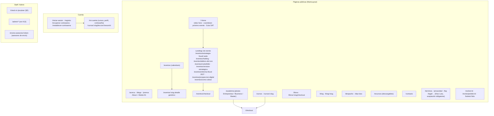

### A2 · Captación de leads (descargables, newsletter, dossiers)

Cualquier “dame tu correo y te mando X” sigue el mismo camino. El componente reutilizable del frontend es `LeadCaptureModal`.

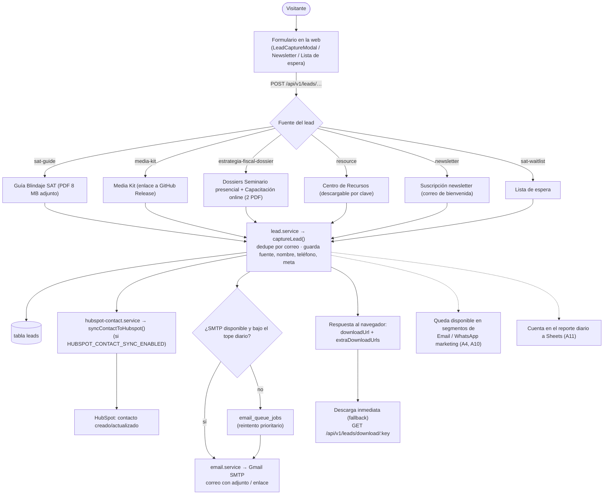

**Además:** cada clic en un botón de WhatsApp del sitio se registra con `POST /api/v1/analytics/wa-click` (tabla `wa_clicks`) y se consulta en el admin.

### A3 · HubSpot (CRM) — dos direcciones

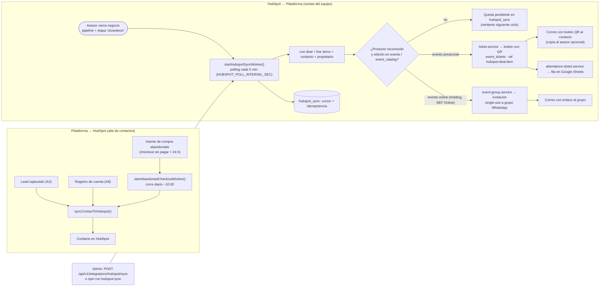

### A4 · Email marketing — Mailchimp + SMTP

Hay **dos canales de correo** y es importante no confundirlos:

| Canal | Para qué | Tope |
|---|---|---|
| **Gmail SMTP (nodemailer)** | Transaccionales (boletos, recibos, descargables, bienvenida) y envíos masivos pequeños desde el admin | ~1 950/día total; `EMAIL_BULK_DAILY_CAP` = 1 800 para masivos; se reservan ~150 para transaccionales |
| **Mailchimp** | Campañas masivas a la audiencia “Diego Díaz – Estrategia Fiscal” y segmentos que ya viven allá | Según plan Mailchimp |

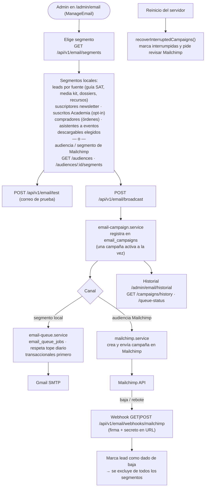

### A5 · Pagos con Stripe (cursos, Academia, eventos, libros)

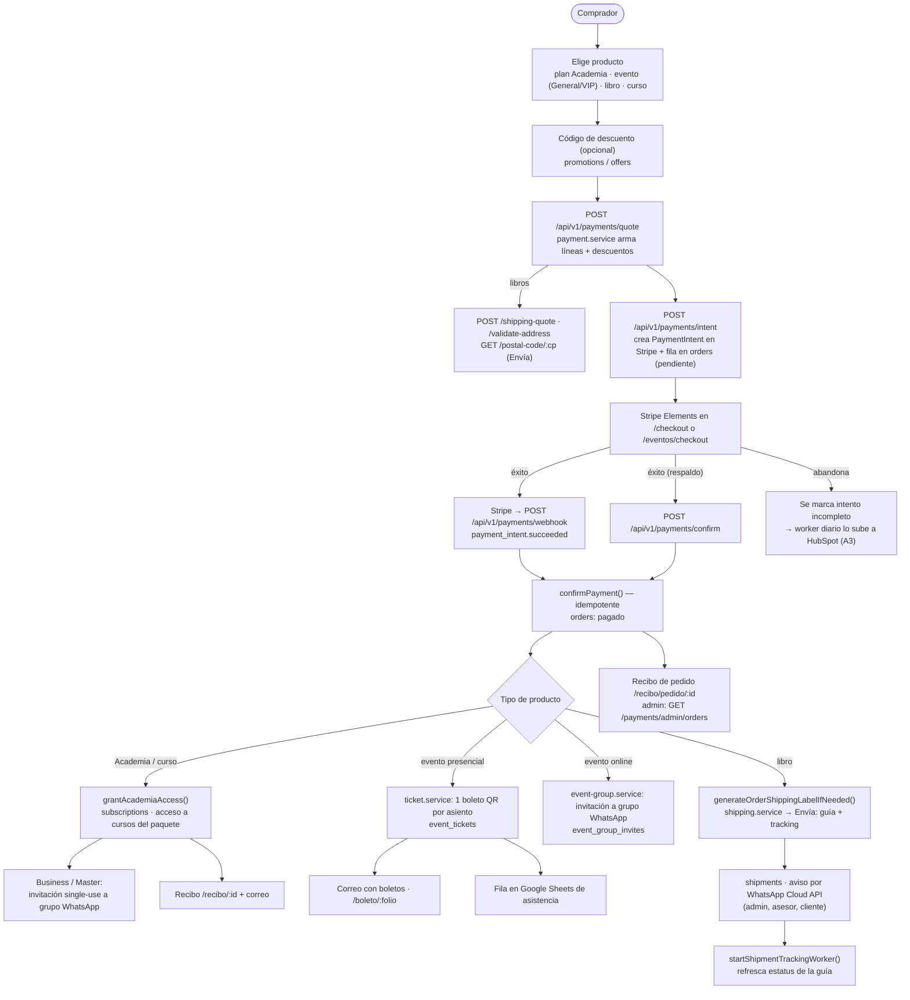

### A6 · Eventos, boletos y check‑in

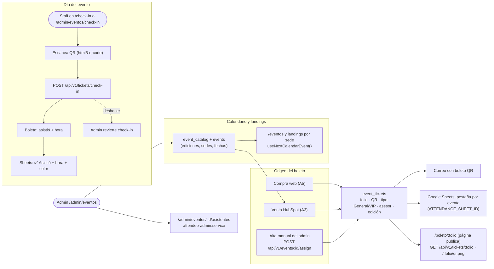

### A7 · Academia (planes, cursos, expiración)

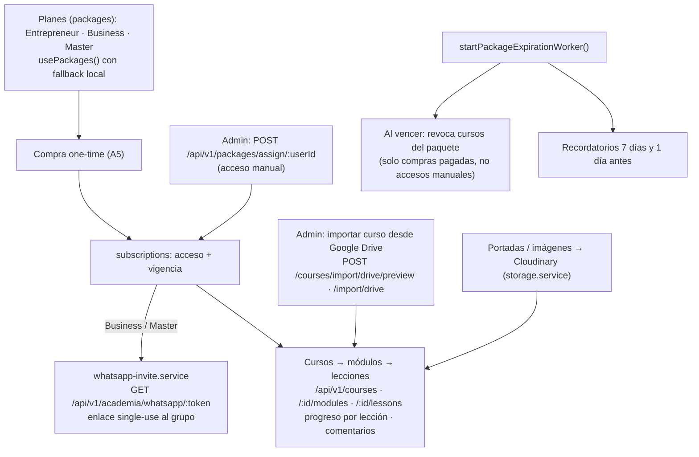

### A8 · Cuentas y autenticación

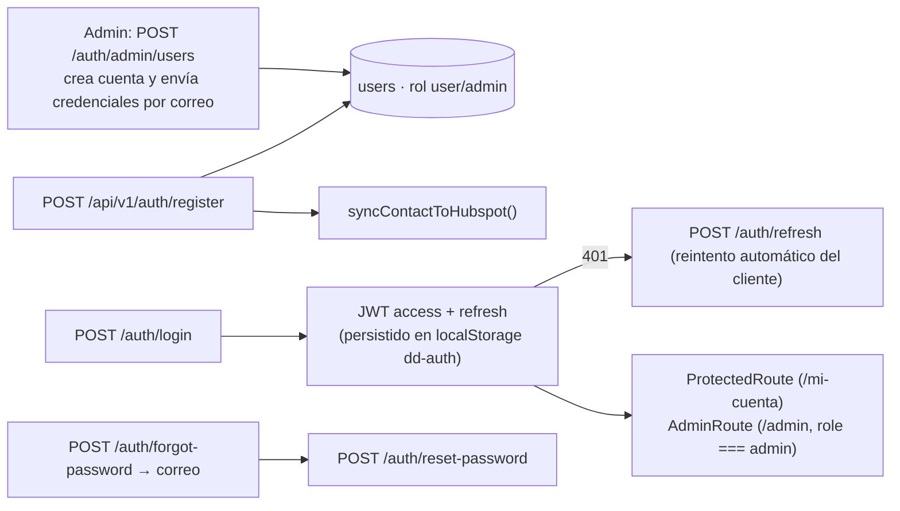

### A9 · Blog

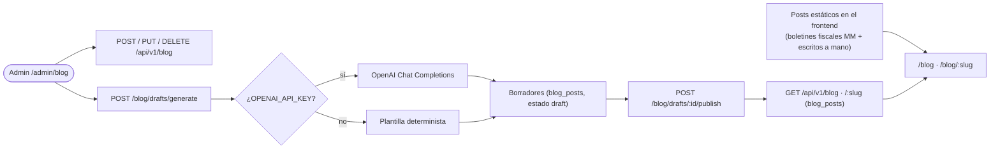

### A10 · WhatsApp (tres usos distintos)

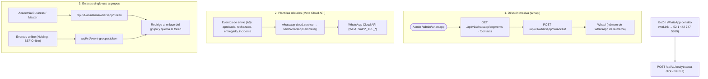

### A11 · Reportes a Google Sheets

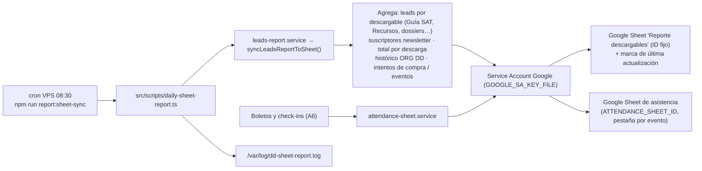

### A12 · Workers automáticos del backend (arrancan con `server.ts`)

| Worker | Qué hace | Frecuencia |
|---|---|---|
| `startEmailQueueWorker()` | Despacha `email_queue_jobs` respetando topes diarios; transaccionales primero | continuo (intervalo interno) |
| `startPackageExpirationWorker()` | Recordatorios 7d/1d y revocación de paquetes vencidos | diario |
| `startHubspotSyncWorker()` | Polling de negocios ganados en HubSpot → boletos / invitaciones | cada 5 min |
| `startAbandonedCheckoutWorker()` | Sube a HubSpot intentos de compra abandonados > 24 h | diario ~10:00 |
| `startShipmentTrackingWorker()` | Actualiza tracking de guías Envía | intervalo interno |
| `recoverInterruptedCampaigns()` | Al arrancar, marca campañas de email interrumpidas | al inicio |
| cron externo `report:sheet-sync` | Reporte de leads a Sheets (A11) | 08:30 diario |

### A13 · Panel admin (`/admin/*`) → endpoints

| Pantalla | Ruta | Backend principal |
|---|---|---|
| Dashboard | `/admin` | resumen |
| Cursos / productos | `/admin/cursos`, `/admin/cursos/:id`, `/admin/cursos/:id/avance`, `/admin/comentarios` | `/courses`, `/modules`, `/lessons`, comentarios |
| Contactos (contactos · etiquetas · leads) | `/admin/contactos`, `/admin/contactos/:id`, `/admin/etiquetas` | `/leads`, `/leads/unified`, `/users`, `/tags` |
| Eventos | `/admin/eventos`, `/admin/eventos/check-in`, `/admin/eventos/:id/asistentes` | `/events`, `/tickets`, `/integrations/event-catalog`, `/event-groups` |
| Ventas | `/admin/ventas`, `/admin/ventas/pagos`, `/admin/ventas/carrito` | `/payments/admin/orders`, `/receipts` |
| Envíos | `/admin/envios`, `/envios-asesores/:token` | `/shipments` |
| Suscripciones / paquetes / ofertas / promociones | `/admin/suscripciones`, `/admin/promociones` | `/subscriptions`, `/packages`, `/offers`, `/promotions` |
| Email | `/admin/email`, `/admin/email/historial` | `/email/*` (A4) |
| WhatsApp | `/admin/whatsapp` | `/whatsapp/*` (A10) |
| Blog | `/admin/blog` | `/blog/*` (A9) |
| Usuarios | `/admin/usuarios` | `/users`, `/auth/admin/users` |

**Tablas de `dd_academia`:** `users, courses, modules, lessons, events, event_catalog, event_tickets, event_group_invites, orders, subscriptions, packages, offers, promotions, tags, books, blog_posts, course_comments, leads, wa_clicks, email_campaigns, email_queue_jobs, hubspot_sync, shipments, shipping_advisors`.

---

## Plataforma B — Díaz Lara Consultores (diazlara.mx)

**Qué es:** la landing del despacho (`DiazLaraweb`, React/Vite, en Hostinger) y una API (`diazlara-backend`, Express/TS, VPS :3000, MySQL **remoto en Hostinger**) que captura solicitudes, califica leads, agenda sesiones estratégicas con consultores en Google Calendar/Meet y avisa por correo y WhatsApp. Es el **puente** entre el marketing (HubSpot) y la operación interna (Plataforma C).

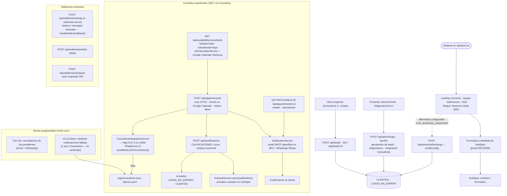

**Plantillas (seed:templates):** email → confirmación, recordatorio, cancelación, seguimiento post‑sesión; WhatsApp → confirmación, recordatorio, cancelación.
**Tablas principales:** `CLIENTES`, `CONSULTORES`, `CITAS`, `CALIFICACIONES`, `LEADS_EN_ESPERA`, disponibilidad/bloqueos, notificaciones y plantillas (esquema exacto vigente: no verificado en el repo).
**Deploy:** backend → `git pull && npm run build && pm2 restart diazlara-backend`. Frontend → Hostinger (proveedor inferido por DNS `*.cdn.hstgr.net`).

---

## Plataforma C — Consultoría interna (fiscalista-mx.com)

**Qué es:** el sistema operativo del despacho. Importa negocios de HubSpot, los convierte en clientes/empresas/servicios, mueve un tablero de etapas sincronizado con el pipeline de HubSpot, dispara automatizaciones por WhatsApp/correo en cada etapa, agenda sesiones con consultores, maneja documentos, checklists, diagnósticos fiscales, ISR, planes de acción, facturación, un portal para el cliente y el “Podio” (ranking de asesores).
**Stack:** React + Vite + MUI/PrimeReact (frontend `Consultoria`), Express + Sequelize + Socket.IO (backend `Consultoria_backend`), MySQL `consultoria_db` local.
**Deploy:** GitHub Actions con **runner self‑hosted en el VPS** (`actions.runner.*` y `github-runner-consultoria.service`): al hacer push, el runner hace `git pull`, compila y reinicia `api_ddl` / regenera `dist/`.

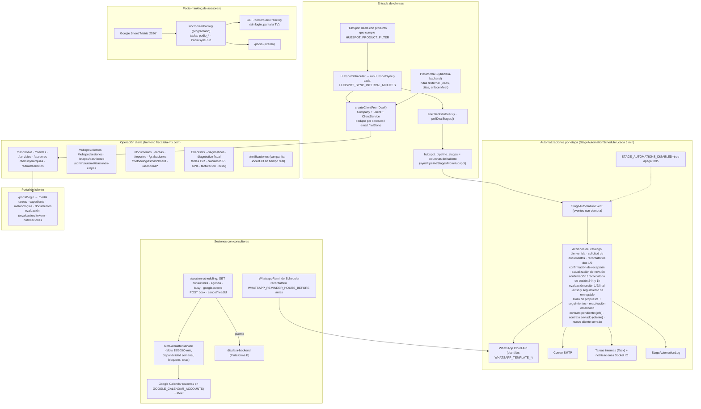

**Roles:** administradores, consultores/asesores con jerarquía (`AsesorHierarchy`), `ASESOR_VENTAS` (acceso completo a HubSpot, lectura de clientes, subida de documentos) y clientes del portal.
**Workers (`setInterval`):** HubSpot sync (`HUBSPOT_SYNC_INTERVAL_MINUTES`), automatizaciones de etapa (5 min), recordatorios WhatsApp (`WHATSAPP_REMINDER_CHECK_INTERVAL_MINUTES`), tareas, Podio.
**Modelos clave:** `User, Profile, Client, Company, Service, ClientService, ClientConsultor, Task, Notification, ActionPlan, Folder, Document, ClientFile, Facturacion, ClientBilling, ClientMonitoring, Methodology*, FiscalDiagnosis*, ISRRateTable, ClientISRCalculation, AsesorHierarchy*, HubspotPipelineStage, HubspotPipelineDeal, StageAutomation*, Podio*, SessionEvaluation, Client*Checklist, ClientHours, Video, SecurityEvent, BlacklistedToken`.

---

## Plataforma D — Ranking de asesores (ranking.diazlara.mx)

Sin backend propio: HTML/JS compilado con Vite (React + React Query + Recharts + Three.js) servido por nginx. Los datos vienen de **n8n cloud** (`diaz-lara.app.n8n.cloud/webhook/...`), que consulta la API de HubSpot y devuelve un dataset optimizado de deals.

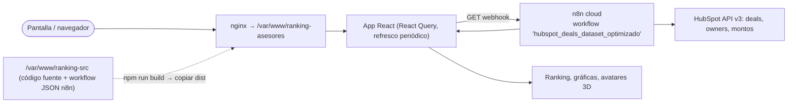

---

## Cómo se conectan las plataformas entre sí

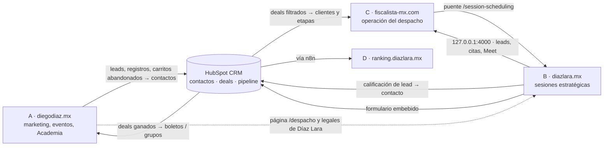

**En una frase:** HubSpot es el **centro**. A lo alimenta con leads y consume sus ventas; B califica y agenda; C opera al cliente a partir de los deals; D solo lo lee para mostrar el ranking.

---

## Servicios externos (tabla rápida)

| Servicio | Lo usa | Para qué | Variables |
|---|---|---|---|
| **HubSpot** | A, B, C, D | CRM central: contactos, deals, pipeline, formularios | `HUBSPOT_*` |
| **Mailchimp** | A | Campañas masivas + webhook de bajas | `MAILCHIMP_*` |
| **Stripe** | A | Pagos (PaymentIntent + webhook) | `STRIPE_*` |
| **Gmail SMTP (nodemailer)** | A, B, C | Transaccionales y envíos pequeños | `MAIL_*` / `SMTP_*` |
| **Whapi** | A, B, C | WhatsApp desde el número de la marca (difusión, confirmaciones, webhook) | `WHAPI_*` |
| **WhatsApp Cloud API (Meta)** | A, C | Plantillas oficiales (envíos, etapas, recordatorios) | `WHATSAPP_*` |
| **Google Sheets** | A, C | Reporte diario de leads, asistencia a eventos, Matriz Podio | `GOOGLE_SA_KEY_FILE`, `ATTENDANCE_SHEET_ID` |
| **Google Calendar / Meet** | B, C | Agenda de consultores, enlaces Meet | `GOOGLE_SERVICE_ACCOUNT_JSON`, `GOOGLE_CALENDAR_*` |
| **Google Drive** | A | Importar cursos (videos, portadas) | `GOOGLE_DRIVE_API_KEY` |
| **Cloudinary** | A | Imágenes optimizadas | `CLOUDINARY_*` |
| **Envía** | A | Guías y tracking de libros | `ENVIA_*` |
| **OpenAI** | A (opcional) | Borradores de blog | `OPENAI_API_KEY` |
| **n8n cloud** | D | Webhooks con dataset de HubSpot | — |
| **GitHub Releases `media-v1`** | A | Videos pesados y Media Kit (75 MB) | — |
| **Hostinger** | A, B | Hosting de frontends + MySQL de B | — |
| **Cloudflare** | C | DNS/proxy de fiscalista-mx.com | — |

---

## Operación: despliegues, tareas programadas y respaldos

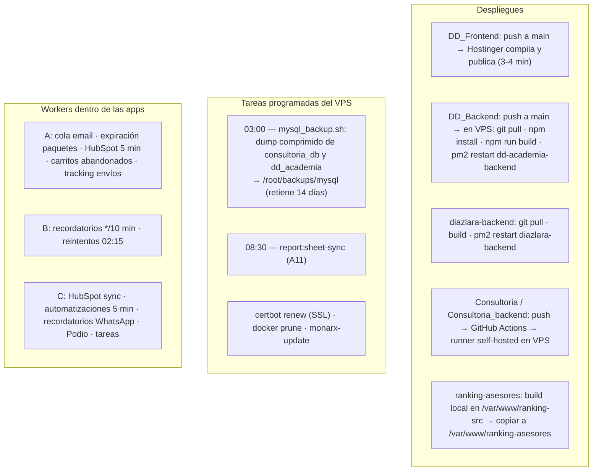

---

## Riesgos y pendientes detectados

| # | Hallazgo | Impacto | Sugerencia |
|---|---|---|---|
| 1 | ✅ **Resuelto 2026‑11‑24.** El backup nocturno solo respaldaba `consultoria_db`. Ahora `/root/backups/mysql_backup.sh` respalda **ambas** bases comprimidas (`*.sql.gz`, 14 días de retención); `dd_academia` usa las credenciales del `.env` del backend con `--no-defaults`. Verificado: 24 tablas en el dump. | — | Pendiente aún: copiar los dumps **fuera del VPS** (Drive/S3/Hostinger). |
| 2 | ✅ **Resuelto 2026‑11‑24.** `api.consultoresddl.com.mx` apuntaba a `:5010`. Sin referencias en código y sin tráfico real (1 bot en logs) → site deshabilitado (sigue en `sites-available` por si se necesita). | — | Si el dominio se retoma, reactivar el site apuntando al backend correcto. |
| 3 | ✅ **Resuelto 2026‑11‑24.** `frontend_ddl` (Vite dev en :5173) detenido en PM2 y guardado (`pm2 save`); nginx no lo usaba. Reversible con `pm2 start frontend_ddl`. | — | — |
| 4 | La BD de Díaz Lara vive en MySQL remoto de Hostinger (`31.97.208.13`): latencia y dependencia de un segundo proveedor. | Medio | Documentar credenciales/respaldo en Hostinger o migrar a MySQL del VPS. |
| 5 | Docker está instalado sin contenedores (solo crons de prune). | Bajo | Eliminar si no hay plan de uso. |
| 6 | Puntos marcados “no verificado” en B y C (esquema exacto de tablas de B, endpoint exacto de `external` en C, intervalos de Podio). | Doc | Completar cuando se toque ese código. |

---

### Glosario mínimo

- **Lead:** persona que dejó su correo/teléfono a cambio de un descargable, newsletter o solicitud; todavía no compra.
- **Deal / negocio:** oportunidad de venta en HubSpot; cuando se marca ganada, A emite boletos y C crea el cliente.
- **Pipeline / etapa:** columnas del proceso comercial en HubSpot; C las copia como tablero y dispara automatizaciones.
- **Boleto (ticket):** acceso a evento con folio y QR; se valida con el escáner en el check‑in.
- **Invitación single‑use:** enlace que solo funciona una vez para entrar a un grupo de WhatsApp.
- **PM2:** administrador que mantiene vivos los procesos Node en el VPS.
- **nginx:** la “puerta de entrada” que decide a qué proceso mandar cada dominio.
