# Manual de Usuario General — Cómo funciona todo

> **Para quién es:** cualquier persona del equipo — ventas, marketing, soporte, administración, un dev que acaba de llegar. No necesitas saber programar.
> **Qué vas a entender al terminar:** qué páginas web tenemos, dónde viven, qué pasa "por detrás" cuando alguien deja su correo, compra un boleto, paga la Academia, agenda una sesión o cuando un asesor cierra una venta en HubSpot. Y qué hacer (o a quién avisar) cuando algo se ve raro.
> **Si quieres la versión técnica** (puertos, tablas, endpoints), está en [`ARQUITECTURA-VPS-Y-PLATAFORMAS.md`](./ARQUITECTURA-VPS-Y-PLATAFORMAS.md). Este documento es el "mapa del tesoro"; aquel es el "plano del ingeniero".

---

## Índice

1. [La idea en 60 segundos](#1-la-idea-en-60-segundos)
2. [El mapa general (un solo dibujo)](#2-el-mapa-general-un-solo-dibujo)
3. [Las piezas, explicadas como si fueran un edificio](#3-las-piezas-explicadas-como-si-fueran-un-edificio)
4. [Las cuatro plataformas y para qué sirve cada una](#4-las-cuatro-plataformas-y-para-qué-sirve-cada-una)
5. [Historias completas: "qué pasa cuando…"](#5-historias-completas-qué-pasa-cuando)
   - 5.1 Alguien descarga la Guía SAT
   - 5.2 Alguien compra un boleto para un evento
   - 5.3 Un asesor cierra una venta en HubSpot
   - 5.4 Alguien paga la Academia
   - 5.5 Alguien compra un libro
   - 5.6 Marketing manda una campaña de correo
   - 5.7 Marketing manda un WhatsApp masivo
   - 5.8 Llega el día del evento (check‑in)
   - 5.9 Un prospecto pide una sesión con Díaz Lara
   - 5.10 El despacho atiende a un cliente (Consultoría)
   - 5.11 Alguien se registra o pierde su contraseña
   - 5.12 Se publica un artículo en el blog
6. [Las cosas que pasan solas (robots)](#6-las-cosas-que-pasan-solas-robots)
7. [Dónde se guarda cada dato](#7-dónde-se-guarda-cada-dato)
8. [Cómo se publican cambios (deploy)](#8-cómo-se-publican-cambios-deploy)
9. [Guía rápida: "esto se ve raro, ¿qué hago?"](#9-guía-rápida-esto-se-ve-raro-qué-hago)
10. [Las cosas que hay que arreglar o vigilar](#10-las-cosas-que-hay-que-arreglar-o-vigilar)
11. [Diccionario de palabras raras](#11-diccionario-de-palabras-raras)

---

## 1. La idea en 60 segundos

Tenemos **un servidor** (una computadora rentada, encendida 24/7, le decimos *el VPS*) y **cuatro páginas web** que trabajan en equipo:

| Página | En una frase |
|---|---|
| **diegodiaz.mx** | La marca personal de Diego: eventos, Academia, libros, blog, descargables gratis. Es donde **entra la gente**. |
| **diazlara.mx** | El despacho Díaz Lara: aquí un prospecto **agenda una sesión** con un consultor. |
| **fiscalista-mx.com** | El sistema **interno** del despacho: clientes, tareas, documentos, etapas, portal del cliente. Solo lo usa el equipo. |
| **ranking.diazlara.mx** | Una pantalla con el **ranking de ventas** de los asesores. Solo muestra, no guarda nada. |

En medio de todas está **HubSpot**, nuestro CRM. Piensa en HubSpot como **la libreta central de contactos y ventas**: todo lo que una página aprende de una persona lo anota ahí, y las otras páginas lo leen de ahí.

Alrededor hay ayudantes externos: **Stripe** cobra con tarjeta, **Mailchimp** manda correos masivos, **Gmail** manda correos uno a uno, **WhatsApp** (dos proveedores) manda mensajes, **Google Sheets/Calendar/Drive** guardan reportes, agendas y videos, **Envía** genera guías de paquetería, **Cloudinary** guarda imágenes.

---

## 2. El mapa general (un solo dibujo)

Léelo de izquierda a derecha: la gente llega por las páginas, las páginas hablan con sus "cerebros" (APIs) en el servidor, los cerebros guardan en bases de datos y hablan con los servicios externos. HubSpot está en el centro porque todas lo tocan.

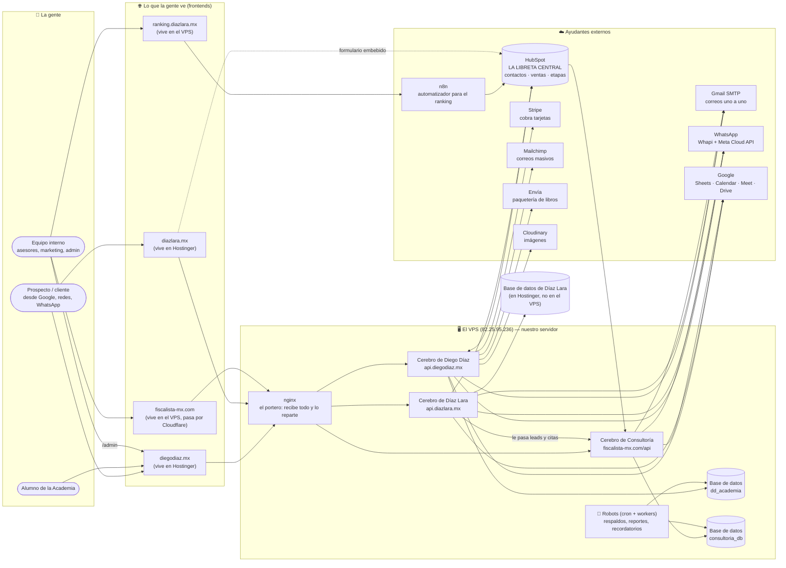

**Cómo leer el dibujo con una analogía:** las páginas son **las vitrinas de la tienda**. El VPS es **la trastienda**. nginx es **el portero** que ve a qué dominio quieres entrar y te manda con el cerebro correcto. Cada cerebro tiene **su propio archivero** (base de datos). HubSpot es **la libreta compartida** que todos los cerebros consultan y anotan. Los robots son **empleados nocturnos** que hacen tareas repetitivas sin que nadie les pida.

---

## 3. Las piezas, explicadas como si fueran un edificio

### El terreno: el VPS
Es una computadora rentada (Ubuntu, 4 procesadores, 15 GB de RAM, 193 GB de disco, usamos ~19 %). Está encendida siempre. Dentro viven:

- **nginx — el portero.** Todo lo que llega por internet (https) primero pasa por él. Mira el dominio (`api.diegodiaz.mx`, `fiscalista-mx.com`, etc.) y lo entrega al departamento correcto. También tiene los **candados SSL** (el candadito verde del navegador) que se renuevan solos.
- **PM2 — el supervisor de turno.** Mantiene vivos a los "cerebros". Si uno se cae, lo levanta. Hay cuatro bajo su cuidado:
  1. `dd-academia-backend` → cerebro de **Diego Díaz**.
  2. `diazlara-backend` → cerebro de **Díaz Lara**.
  3. `api_ddl` → cerebro de **Consultoría**.
  4. `frontend_ddl` → un proceso de desarrollo de Consultoría que estaba de más; **ya se detuvo** (ver sección 10).
- **MySQL — los archiveros.** Dos cajones: `dd_academia` (todo Diego Díaz) y `consultoria_db` (todo Consultoría). El de Díaz Lara está en otro edificio (Hostinger).
- **cron — el reloj de tareas.** A las **03:00** respalda las dos bases de datos (Diego Díaz y Consultoría); a las **08:30** manda el reporte de leads a Google Sheets.
- **Runner de GitHub — el albañil automático.** Cuando un dev sube cambios de Consultoría, este robot los instala en el servidor solo.
- **Seguridad:** fail2ban (bloquea a quien intenta adivinar contraseñas por SSH), Monarx (antimalware).

### Las vitrinas que NO están en el VPS
- **diegodiaz.mx** y **diazlara.mx** viven en **Hostinger** (un hosting web). Cuando un dev sube cambios a GitHub, Hostinger los publica solo en 3‑4 minutos. Por eso **la página puede estar bien y el cerebro caído, o al revés**: son edificios distintos.
- **fiscalista-mx.com** pasa primero por **Cloudflare** (un escudo/CDN) y luego llega al VPS.

---

## 4. Las cuatro plataformas y para qué sirve cada una

### A · diegodiaz.mx — "la puerta de entrada"
Lo que ve el público:
- **Inicio** con video, cuenta regresiva del próximo evento y la Guía SAT gratis.
- **Eventos**: calendario y una landing por cada evento (Seminario Estrategia Fiscal *por sede*, Holding, Tablero del CEO, Rockefeller, Revisión Estratégica, Reforma Fiscal 2027, Prospección Digital, Cómo Cobrar). Desde ahí se compran boletos.
- **Academia**: tres planes (Entrepreneur, Business, Master) con cursos en video.
- **Libros** con envío a domicilio.
- **Blog**, **Recursos** (descargables), **Acerca**, **Prensa** (media kit), **Despacho/Díaz Lara**, **Contacto**, **Términos/Privacidad/FAQ**.
- **Mi cuenta** para alumnos; **/admin** para el equipo; **/check-in** para el staff del evento.

### B · diazlara.mx — "la recepción del despacho"
Landing del despacho con un **formulario de HubSpot** incrustado y, por detrás, un sistema para que los consultores vean su agenda, creen citas (con enlace de Google Meet), califiquen al prospecto y le manden confirmaciones por correo y WhatsApp. Cuando se agenda algo, se lo cuenta a Consultoría.

### C · fiscalista-mx.com — "la oficina"
Solo para el equipo. Importa las ventas de HubSpot y las convierte en **clientes**; muestra un **tablero de etapas** igual al pipeline de HubSpot; en cada etapa dispara **mensajes automáticos** (bienvenida, pedir documentos, recordar sesión, mandar propuesta, etc.); administra **tareas, documentos, checklists, diagnósticos fiscales, cálculos de ISR, facturación**; tiene un **portal** donde el cliente entra a ver su expediente; y el **Podio** (ranking interno de asesores desde una hoja de Google).

### D · ranking.diazlara.mx — "la pantalla de la TV"
Una página que cada tanto le pregunta a **n8n** (un automatizador en la nube) "¿cómo van las ventas?", n8n le pregunta a HubSpot, y la página dibuja el ranking. No guarda nada.

---

## 5. Historias completas: "qué pasa cuando…"

Cada historia va paso a paso. Las cajas 🟢 son cosas que **la persona ve**; las 🔵 son cosas que **pasan por detrás**; las 🟠 son **robots** que actúan después.

### 5.1 Alguien descarga la Guía SAT (o cualquier descargable, newsletter, dossier)

> *"María llega a diegodiaz.mx desde un anuncio, ve 'Descarga la Guía de Blindaje SAT', pone su nombre, correo y teléfono, y da clic."*

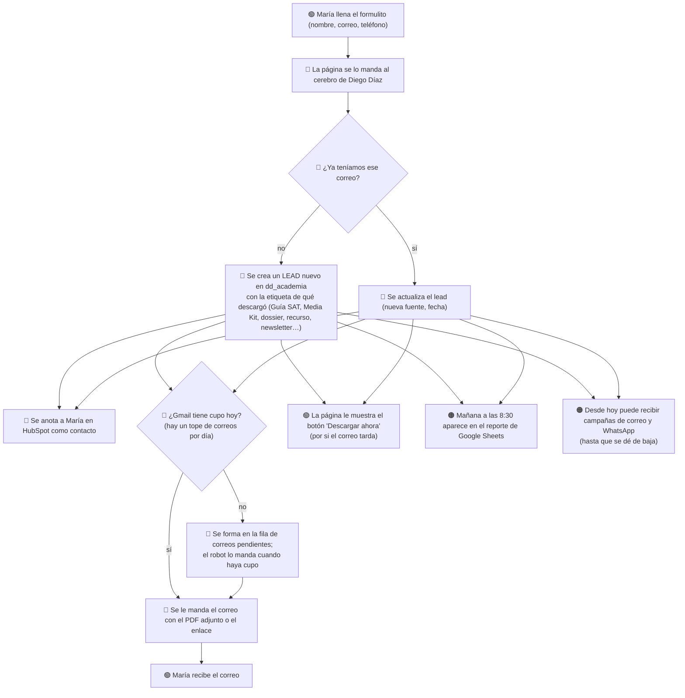

**Lo que debes saber:**
- Todos los descargables usan **el mismo camino**. Cambia solo *qué* se manda (Guía SAT, Media Kit, los dos dossiers de Estrategia Fiscal, recursos, bienvenida al newsletter).
- Si María **no recibe el correo**, 90 % de las veces es porque se acabó el cupo diario de Gmail (ver sección 9). El PDF igual se lo pudo bajar desde la página.
- En el admin (**/admin/contactos**) la ves como lead, con su fuente. En HubSpot la ves como contacto.
- Cada clic en un botón de WhatsApp de la página también se cuenta (para saber de dónde viene la gente).

### 5.2 Alguien compra un boleto para un evento

> *"Luis entra a la landing del Seminario de Estrategia Fiscal en Monterrey, elige 2 boletos VIP, pone un código de descuento y paga con tarjeta."*

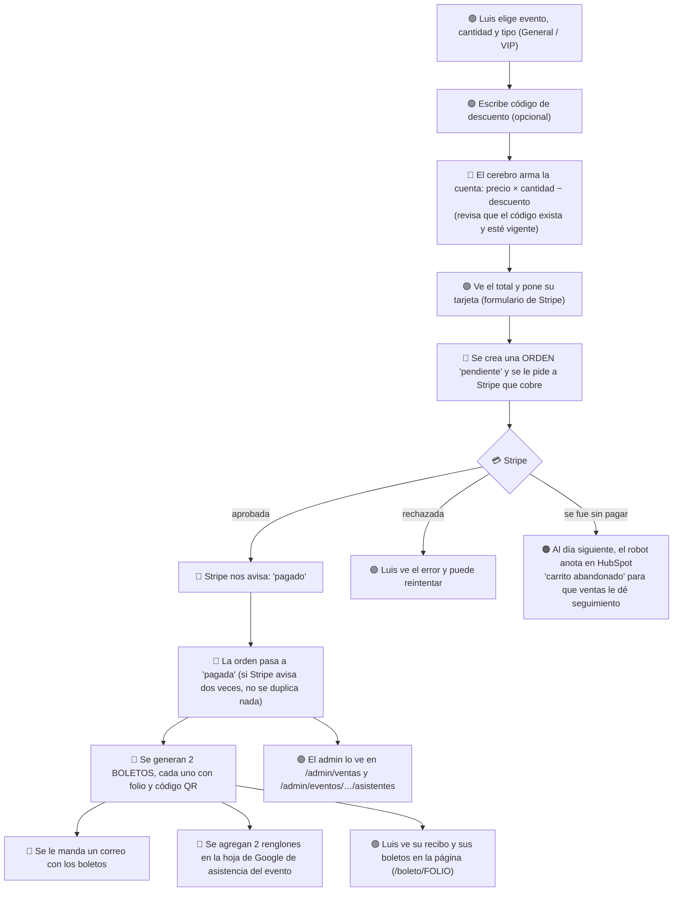

**Si el evento es online** (Holding, Estrategia Fiscal Online): en lugar de boletos con QR se le manda un **enlace de un solo uso** para entrar al grupo de WhatsApp del evento.

### 5.3 Un asesor cierra una venta en HubSpot

> *"Ana, asesora, vende por teléfono 1 boleto del Tablero del CEO. Lo registra en HubSpot como negocio ganado con el producto correcto. No toca nuestra página."*

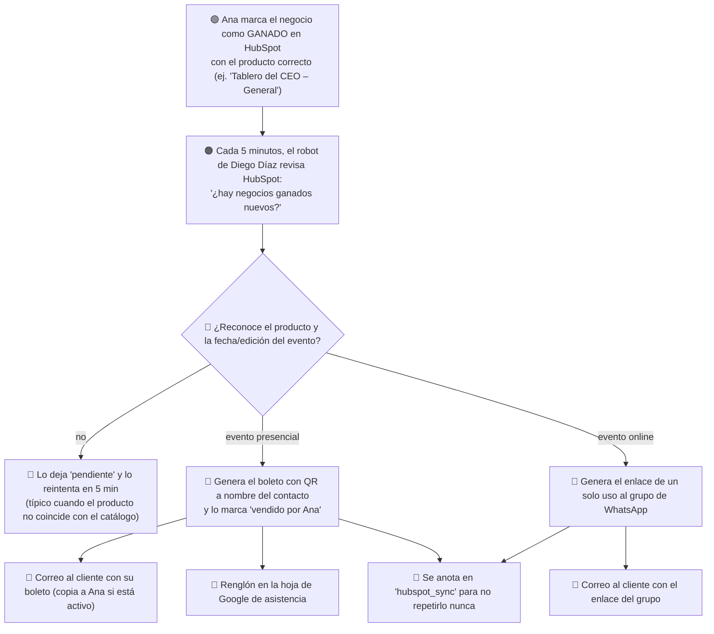

**Lo que debes saber:**
- **La venta no se duplica**: cada negocio + producto de HubSpot se procesa una sola vez.
- Si el boleto **no llega**, casi siempre es porque el **producto en HubSpot no coincide** con el catálogo de eventos (nombre, sede o fecha). El admin puede forzar la revisión desde el panel ("Sincronizar HubSpot").
- Esto también funciona **al revés**: cuando alguien compra en la página, ya está en HubSpot como contacto (paso 5.1 / 5.2).

### 5.4 Alguien paga la Academia

> *"Pedro compra el plan Business desde /academia."*

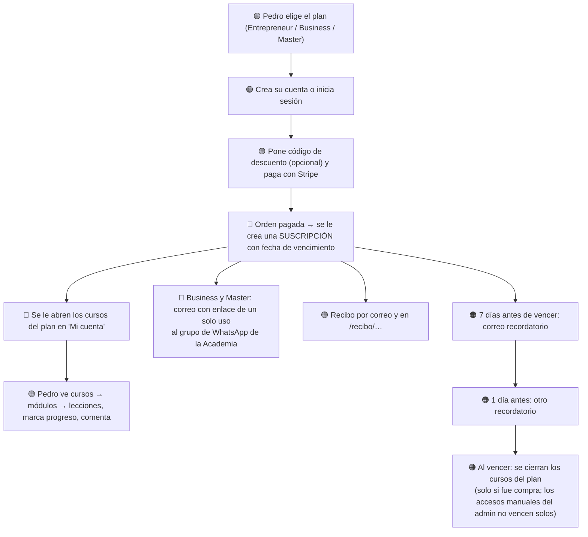

El admin también puede **regalar o asignar acceso a mano** desde /admin/suscripciones. Los videos de los cursos se pueden **importar desde Google Drive** y las portadas se guardan en Cloudinary.

### 5.5 Alguien compra un libro

> *"Sofía compra 'El Tablero del CEO' en físico."*

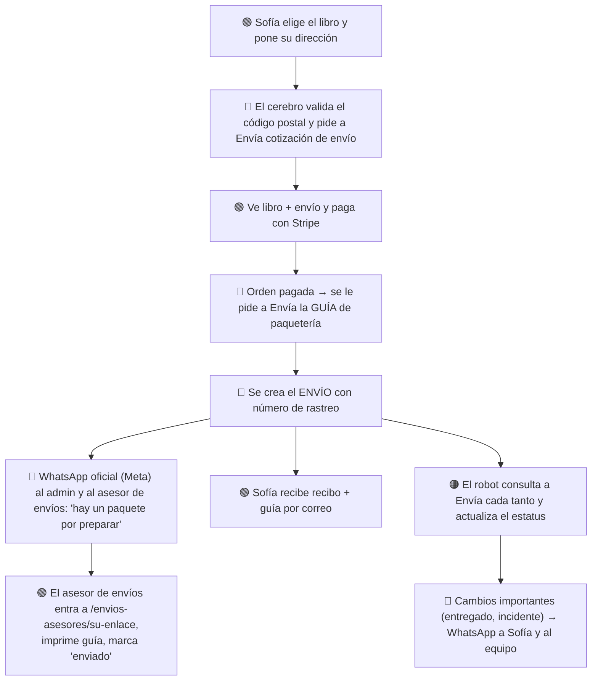

### 5.6 Marketing manda una campaña de correo

> *"Carla quiere avisar del próximo seminario a todos los que bajaron la Guía SAT y a los suscriptores del newsletter."*

Hay **dos tuberías de correo** y conviene saber cuál usar:

| Tubería | Cuándo usarla | Límite |
|---|---|---|
| **Gmail (desde el admin)** | Segmentos **nuestros**: leads por descargable, newsletter, compradores, asistentes, alumnos | ~1 800 correos al día para masivos (Gmail nos corta si pasamos ~2 000). Los correos importantes (boletos, recibos) **siempre tienen prioridad**. |
| **Mailchimp** | Audiencias grandes que ya viven en Mailchimp | El del plan de Mailchimp |

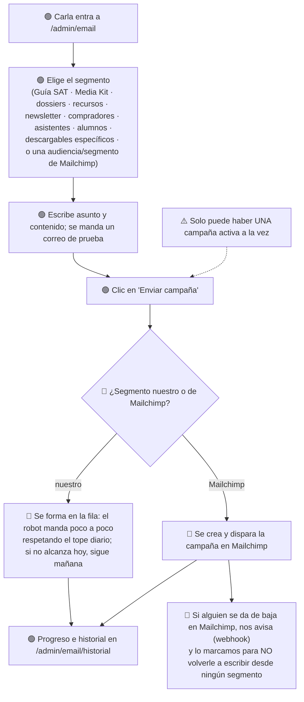

### 5.7 Marketing manda un WhatsApp masivo

> *"Carla quiere mandar un recordatorio por WhatsApp a los asistentes del evento de la semana pasada."*

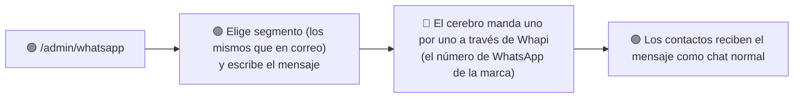

**Ojo:** hay **tres usos distintos** de WhatsApp y no se mezclan:
1. **Difusión masiva** (Whapi) — lo de arriba.
2. **Mensajes oficiales con plantilla** (Meta Cloud API) — avisos de envíos de libros, y en Consultoría los mensajes de cada etapa.
3. **Enlaces de un solo uso a grupos** — Academia Business/Master y eventos online. El enlace sirve **una vez**; si lo reenvían, no funciona.

### 5.8 Llega el día del evento (check‑in)

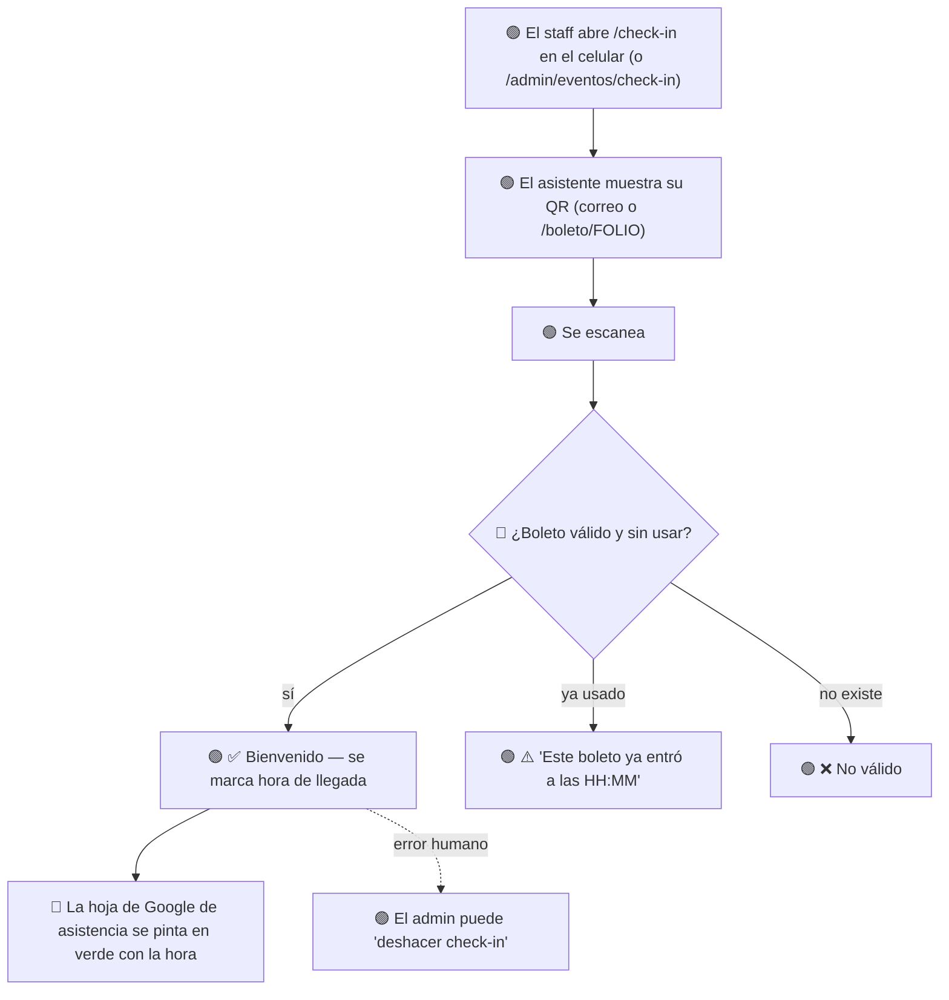

Los boletos pueden venir de **tres lugares**: compra web, venta por HubSpot o alta manual del admin. Al escáner le da igual.

### 5.9 Un prospecto pide una sesión con Díaz Lara

> *"Roberto entra a diazlara.mx, llena el formulario de 'Asesoría Inicial 2026'."*

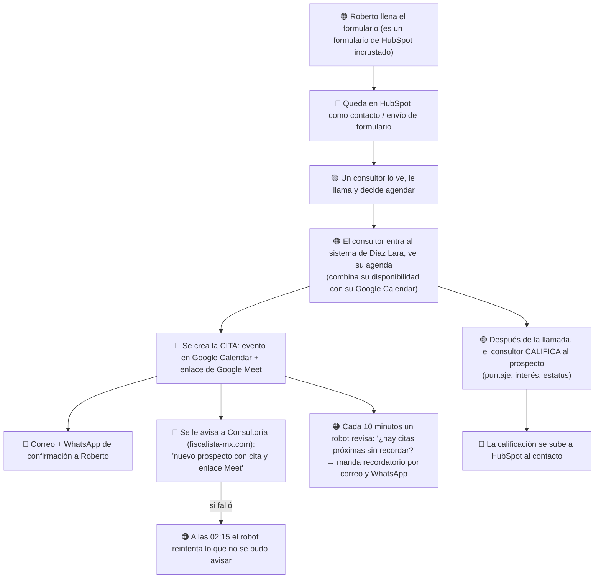

**Dato importante:** la base de datos de Díaz Lara **no está en nuestro VPS**, está en Hostinger. Si Hostinger tiene un problema, este sistema se afecta aunque el VPS esté perfecto.

### 5.10 El despacho atiende a un cliente (Consultoría)

> *"Roberto compró el servicio. Ana lo marca como ganado en HubSpot con el producto 'Consultoría fiscal'."*

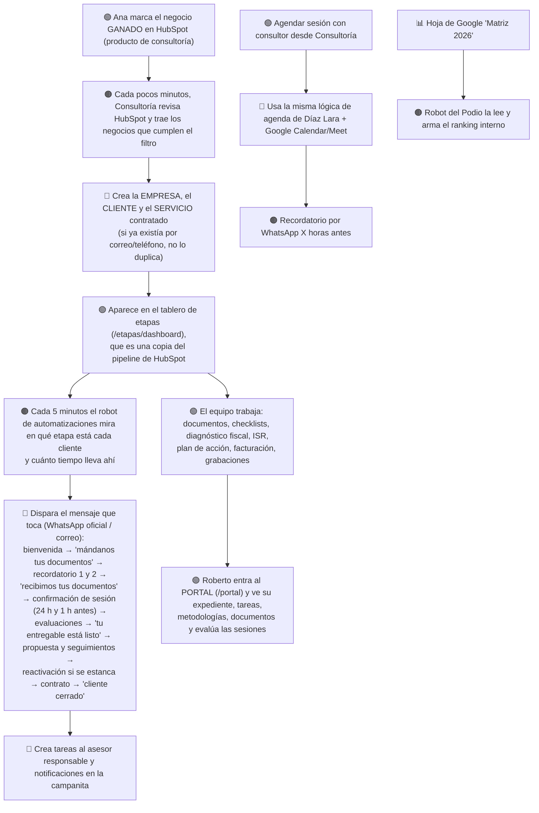

**Botón de pánico:** si las automatizaciones mandan algo que no deben, existe un interruptor (`STAGE_AUTOMATIONS_DISABLED`) que las apaga todas. Lo activa un dev.

### 5.11 Alguien se registra o pierde su contraseña

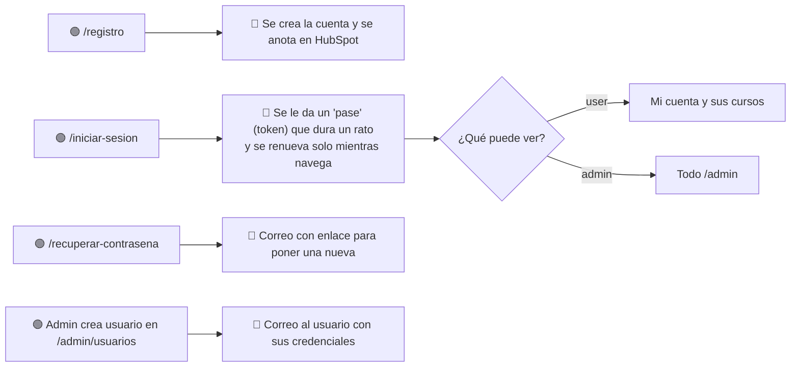

### 5.12 Se publica un artículo en el blog

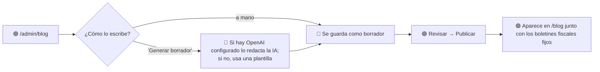

---

## 6. Las cosas que pasan solas (robots)

Nadie las dispara; están programadas. Si algo "mágicamente" pasó o dejó de pasar, probablemente es uno de estos.

| Robot | Dónde vive | Cada cuánto | Qué hace |
|---|---|---|---|
| Fila de correos | Diego Díaz | Todo el tiempo | Manda los correos pendientes respetando el tope diario de Gmail; los importantes primero |
| Vigilante de HubSpot | Diego Díaz | Cada 5 min | Busca negocios ganados y genera boletos / enlaces de grupo |
| Carritos abandonados | Diego Díaz | Diario ~10:00 | Sube a HubSpot a quien empezó a pagar y no terminó (más de 24 h) |
| Vencimientos de Academia | Diego Díaz | Diario | Recordatorios 7 d y 1 d antes; cierra el acceso al vencer |
| Rastreo de paquetes | Diego Díaz | Cada tanto | Pregunta a Envía por el estatus y avisa por WhatsApp |
| Reporte de leads | VPS (cron) | Diario 08:30 | Llena la hoja de Google "Reporte descargables" |
| Respaldo de BD | VPS (cron) | Diario 03:00 | Respalda `dd_academia` y `consultoria_db` comprimidas; guarda 14 días |
| Recordatorios de cita | Díaz Lara | Cada 10 min | Correo + WhatsApp antes de la sesión |
| Reintentos | Díaz Lara | Diario 02:15 | Reintenta avisos y sincronizaciones que fallaron |
| Importador de HubSpot | Consultoría | Cada pocos min | Crea clientes desde negocios ganados; copia etapas |
| Automatizaciones por etapa | Consultoría | Cada 5 min | Manda el mensaje que corresponde a la etapa y tiempo |
| Recordatorios WhatsApp | Consultoría | Configurable | Recuerda sesiones X horas antes |
| Podio | Consultoría | Programado | Lee la hoja "Matriz 2026" y arma el ranking |
| Ranking TV | n8n (nube) | Al refrescar la página | Pide a HubSpot los datos de ventas |

---

## 7. Dónde se guarda cada dato

"¿Dónde busco a esta persona?" — guía rápida:

| Quiero ver… | Lo encuentro en… |
|---|---|
| Quién descargó qué, suscriptores, leads | **/admin/contactos** en diegodiaz.mx · también en **HubSpot** como contacto · resumen en la **hoja de Google de leads** |
| Quién compró qué (boletos, Academia, libros) | **/admin/ventas** · recibos en /recibo · también en **Stripe** (dinero real) |
| Boletos y asistencia a un evento | **/admin/eventos → asistentes** · **hoja de Google de asistencia** (una pestaña por evento) |
| Alumnos y vencimientos de Academia | **/admin/suscripciones** |
| Envíos de libros | **/admin/envios** · guía en **Envía** |
| Campañas de correo enviadas | **/admin/email/historial** · en **Mailchimp** si fue por ahí |
| Ventas del equipo, pipeline, etapas | **HubSpot** (la verdad oficial) |
| Citas y calificaciones de prospectos del despacho | Sistema de **Díaz Lara** · reflejo en HubSpot · **Google Calendar** del consultor |
| Expediente de un cliente del despacho | **fiscalista-mx.com** (clientes, documentos, tareas) · el cliente lo ve en **/portal** |
| Ranking de asesores | **ranking.diazlara.mx** (ventas HubSpot) · **/podio** en Consultoría (hoja Matriz 2026) |

**Y físicamente:** todo lo de Diego Díaz está en la base `dd_academia` (VPS); todo lo de Consultoría en `consultoria_db` (VPS); lo de Díaz Lara en una base en Hostinger. Imágenes en Cloudinary, videos pesados en Google Drive / GitHub Releases.

---

## 8. Cómo se publican cambios (deploy)

Para que entiendas por qué a veces "ya está" y a veces "todavía no":

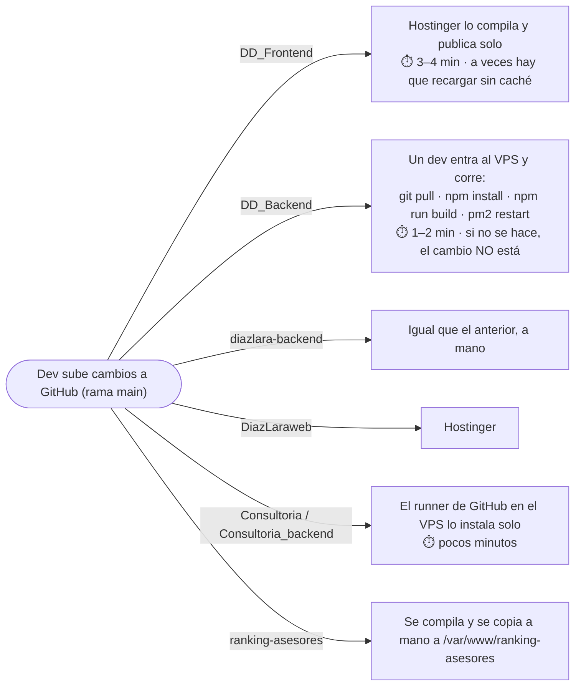

**Regla práctica:** si un cambio es **visual** (textos, colores, páginas) suele ser frontend y sale solo; si es **de lógica** (correos, boletos, pagos, HubSpot) suele ser backend y alguien tiene que publicarlo en el VPS.

---

## 9. Guía rápida: "esto se ve raro, ¿qué hago?"

| Síntoma | Causa más probable | Qué revisar / a quién avisar |
|---|---|---|
| La persona no recibió el correo del descargable / boleto | Se agotó el cupo diario de Gmail; el correo está en la fila | Ver `/admin/email` → estado de la fila. Pedirle que lo descargue desde la página o reenviar mañana. Si urge, un dev puede mandarlo a mano. |
| Un asesor vendió en HubSpot y el boleto no salió | El producto/edición en HubSpot no coincide con el catálogo de eventos | Revisar nombre, sede y fecha del producto en HubSpot vs `/admin/eventos`. Luego "Sincronizar HubSpot" en el admin. |
| El pago se cobró pero no hay orden/boleto | Stripe avisó pero el cerebro estaba caído | Un dev revisa Stripe (evento `payment_intent.succeeded`) y confirma la orden; el sistema no duplica. |
| La página carga pero "no trae datos" (eventos, cursos vacíos) | El cerebro (`api.diegodiaz.mx`) está caído o reiniciándose | Dev: `pm2 status` en el VPS. La página (Hostinger) y el cerebro (VPS) son edificios distintos. |
| La página ni siquiera abre | Hostinger (diegodiaz / diazlara) o Cloudflare (fiscalista) | Revisar estado del hosting; no es el VPS. |
| Se mandó un WhatsApp de etapa que no debía | Automatización de Consultoría | Revisar `/admin/automatizaciones-etapas`; en emergencia un dev activa `STAGE_AUTOMATIONS_DISABLED`. |
| Alguien dice "me siguen llegando correos y ya me di de baja" | Se dio de baja en un canal (Mailchimp) y le escribieron por el otro (Gmail), o al revés | Marcarlo como baja en ambos; el webhook de Mailchimp ya lo hace si la baja fue ahí. |
| El enlace del grupo de WhatsApp "no sirve" | Es de un solo uso y ya se usó, o lo reenviaron | Generar uno nuevo desde el admin del evento / Academia. |
| La cuenta regresiva o el calendario muestran un evento viejo | Falta actualizar el catálogo de eventos | `/admin/eventos` → fechas/ediciones. |
| El ranking de la TV se quedó congelado | n8n o HubSpot no respondieron | Recargar; si persiste, revisar el workflow en n8n. |
| El reporte de Google Sheets no se actualizó hoy | El cron de las 08:30 falló | Dev: ver `/var/log/dd-sheet-report.log` en el VPS. |

---

## 10. Las cosas que hay que arreglar o vigilar

Encontradas al revisar el servidor y el código. Las tres primeras **ya se corrigieron el 24‑nov‑2026**:

1. ✅ **La base de datos de Diego Díaz (`dd_academia`) ya se respalda** junto con la de Consultoría, todas las noches a las 03:00 (antes solo se respaldaba Consultoría). Queda pendiente guardar una copia **fuera del servidor** (por ejemplo en Google Drive), por si el VPS entero falla.
2. ✅ **`api.consultoresddl.com.mx`** apuntaba al cerebro equivocado y nadie lo usaba → se apagó (la configuración se conservó por si algún día se necesita).
3. ✅ **El proceso de desarrollo `frontend_ddl`** que sobraba en el servidor se detuvo (se puede volver a encender si hiciera falta).
4. 🟡 **La base de Díaz Lara vive en Hostinger**, fuera de nuestro control directo. Documentar accesos y respaldos o migrarla al VPS.
5. ⚪ Docker instalado sin usarse. Limpiar.
6. ⚪ Algunos detalles de Díaz Lara y Consultoría (esquema exacto de tablas, intervalos del Podio) no se verificaron a fondo; completar cuando se toque ese código.

---

## 11. Diccionario de palabras raras

- **VPS** — la computadora rentada donde viven los "cerebros". Está en la dirección `82.25.95.236`.
- **Frontend / página** — lo que la gente ve en el navegador.
- **Backend / cerebro / API** — el programa que hace el trabajo real (guardar, cobrar, mandar correos). La gente no lo ve.
- **Base de datos** — el archivero donde se guarda todo de forma ordenada.
- **nginx** — el portero del servidor; decide a qué cerebro va cada dominio.
- **PM2** — el supervisor que mantiene vivos los cerebros.
- **cron** — el reloj que dispara tareas a horas fijas.
- **Deploy / publicar** — poner los cambios nuevos en el servidor real.
- **Hostinger** — la empresa donde viven las páginas diegodiaz.mx y diazlara.mx (y la base de datos de Díaz Lara).
- **Cloudflare** — el escudo por el que pasa fiscalista-mx.com.
- **HubSpot** — nuestro CRM: la libreta central de contactos, negocios y etapas.
- **Lead** — una persona que dejó sus datos pero aún no compra.
- **Contacto** — una persona en HubSpot (puede ser lead, cliente o alumno).
- **Negocio / deal** — una oportunidad de venta en HubSpot. "Ganado" = vendido.
- **Pipeline / etapa** — las columnas por las que avanza un negocio o un cliente.
- **Orden** — una compra en nuestra página (pagada o pendiente).
- **Boleto / ticket** — acceso a un evento, con folio y QR.
- **Check‑in** — escanear el QR el día del evento.
- **Suscripción (Academia)** — el acceso a cursos con fecha de vencimiento.
- **Segmento** — un grupo de personas al que le mandas una campaña (ej. "los que bajaron la Guía SAT").
- **Webhook** — cuando un servicio externo (Stripe, Mailchimp) **nos avisa** de algo por sí solo.
- **Enlace de un solo uso** — link que funciona una vez y se quema.
- **Whapi** — proveedor para mandar WhatsApp desde el número de la marca como si fuera un chat.
- **Meta Cloud API** — WhatsApp oficial con plantillas aprobadas.
- **Stripe** — quien cobra las tarjetas.
- **Mailchimp** — plataforma de correos masivos.
- **SMTP / Gmail** — el correo "normal" con el que mandamos uno por uno.
- **n8n** — automatizador en la nube que alimenta el ranking.
- **Runner de GitHub** — robot que instala cambios de Consultoría en el servidor.
- **Token / pase** — lo que te identifica cuando ya iniciaste sesión.
